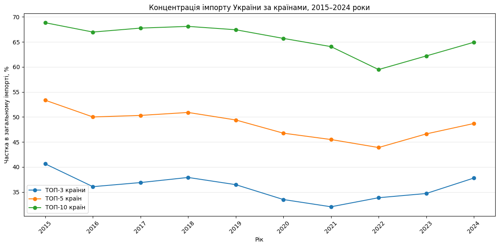

# Зовнішня торгівля України у 2015–2024 роках: що змінилося в експорті, імпорті та структурі постачання

За десять років зовнішня торгівля України зазнала суттєвих змін. Якщо у 2015 році експорт товарів трохи перевищував імпорт, то у 2024-му різниця між ними сягнула майже 29 млрд доларів. Водночас змінилася товарна структура імпорту, зросла частка країн Європейського Союзу, а фізичні обсяги торгівлі після падіння 2022 року так і не повернулися до рівня 2021-го.

Ці тенденції важливі не лише для оцінки зовнішньоторговельної статистики. Вони дають змогу побачити, як змінювалися товарні потоки України, які категорії посилили свої позиції в імпорті та як трансформувалася географія постачання.

Аналіз охоплює 2015–2024 роки й ґрунтується на даних Державної служби статистики України про зовнішню торгівлю товарами. Дослідження зосереджене на п'яти напрямах: динаміці експорту та імпорту, торговельному балансі, товарній структурі імпорту, фізичних обсягах і середніх цінах, а також географії та концентрації країн-постачальників.

## 1\. Експорт та імпорт: від майже рівноваги до значного дефіциту

У 2015 році експорт товарів з України становив близько 38,13 млрд доларів, а імпорт — 37,52 млрд. Таким чином, країна мала невелике позитивне торговельне сальдо — приблизно 0,61 млрд доларів.

У наступні роки вартісні обсяги торгівлі змінювалися нерівномірно. Найвищого значення експорт за досліджуваний період досяг у 2021 році — близько 68,07 млрд доларів. Імпорт того ж року становив 72,84 млрд доларів.

У 2022 році обидва напрями торгівлі скоротилися. Надалі імпорт відновлювався швидше за експорт. У 2024 році його вартість сягнула 70,77 млрд доларів, тоді як експорт становив 41,73 млрд.

Отже, у 2024 році імпорт перевищив експорт приблизно на 29,04 млрд доларів. Експорт покривав близько 58,97% вартості імпорту.

**Графік 1. Динаміка експорту та імпорту України, 2015–2024.**

Графік показує зміну вартісних обсягів експорту та імпорту протягом усього досліджуваного періоду. Він дає змогу побачити розходження між двома показниками після 2021 року.

Для зручності порівняння ключові роки зведено в таблицю.

**Таблиця 1. Експорт, імпорт і торговельне сальдо України у ключові роки, 2015–2024.**

|Рік|Експорт, млрд дол. США|Імпорт, млрд дол. США|Торговельне сальдо, млрд дол. США|
|-:|-:|-:|-:|
|2015|38,13|37,52|0,61|
|2016|36,36|39,25|-2,89|
|2017|43,26|49,61|-6,34|
|2018|47,33|57,19|-9,85|
|2019|50,05|60,80|-10,75|
|2020|49,19|54,34|-5,14|
|2021|68,07|72,84|-4,77|
|2022|44,14|55,30|-11,16|
|2023|37,58|63,76|-26,18|
|2024|41,73|70,77|-29,04|

*Примітка: торговельне сальдо розраховано як різницю між експортом та імпортом. Значення наведено в номінальних доларах США.*

Динаміка свідчить про те, що зростання вартості імпорту не супроводжувалося пропорційним збільшенням експорту. Однак сама різниця між показниками не пояснює причин такого розриву. Для цього потрібен окремий аналіз виробництва, внутрішнього попиту, логістики, цін та інших чинників.

## 2\. Торговельний дефіцит: як змінювалося сальдо

Якщо порівнювати лише вартість експорту та імпорту, можна побачити загальну динаміку. Проте торговельне сальдо чіткіше показує, наскільки вартість експорту покриває вартість імпорту.

У 2015 році різниця була позитивною. У 2021 році сформувався помірний дефіцит — близько 4,77 млрд доларів. У 2022 році він збільшився до 11,16 млрд, а у 2023 році — до 26,18 млрд доларів. У 2024 році дефіцит зріс ще приблизно на 1,47 млрд і досяг 29,04 млрд доларів.

**Графік 2. Торговельне сальдо України, 2015–2024.**

Від'ємне сальдо саме по собі не є достатнім доказом погіршення всіх аспектів економічного стану країни. Імпорт може включати товари для виробництва, інвестицій, відновлення інфраструктури та споживання. Водночас тривала різниця між експортом та імпортом є важливим показником, який потребує уваги під час формування зовнішньоекономічної та промислової політики.

Сам по собі торговельний дефіцит не показує, які саме категорії товарів формують імпорт. Тому наступний етап дослідження — порівняння товарної структури імпорту, щоб визначити, які групи змінили свою частку за досліджуваний період.

## 3\. Товарна структура імпорту: які групи змінили свої позиції

Порівняння товарної структури імпорту у 2015 та 2024 роках показує, що частки окремих категорій помітно змінилися.

Серед десяти відібраних товарних груп найбільше скоротилася частка мінерального палива — з 29,01% у 2015 році до 12,58% у 2024-му. Різниця становить 16,43 відсоткового пункта.

Водночас зросла частка наземного транспорту: з 4,32% до 10,69%, тобто на 6,37 відсоткового пункта. Частка електричних машин та обладнання збільшилася з 7,18% до 11,85% — на 4,67 відсоткового пункта.

Зростання часток також зафіксовано для окремих інших категорій, зокрема літальних апаратів та оптичних і медичних приладів.

**Графік 3. Зміна частки найбільших товарних груп в імпорті України, 2015–2024 роки.**

Графік показує, які товарні групи збільшили або зменшили свою частку в загальному імпорті. Для точного порівняння значень наведено таблицю.

**Таблиця 2. Зміна часток десяти найбільших товарних груп в імпорті України, 2015–2024 роки.**

|Товарна група|2015, %|2024, %|Зміна, в. п.|
|-|-:|-:|-:|
|Група 27. Паливо мінеральне; нафта і продукти її перегонки|29,01|12,58|-16,43|
|Група 85. Електричні машини, обладнання та їх частини|7,18|11,85|4,67|
|Група 87. Наземний транспорт, крім залізничного|4,32|10,69|6,37|
|Група 84. Реактори ядерні, котли, машини, обладнання|9,54|9,40|-0,13|
|Група 39. Пластмаси, полімерні матеріали та вироби з них|5,58|4,05|-1,53|
|Група 30. Фармацевтична продукція|3,64|3,44|-0,21|
|Група 90. Прилади та апарати оптичні, фотографічні, медичні|1,20|2,46|1,26|
|Група 72. Чорні метали|1,83|2,10|0,27|
|Група 88. Літальні апарати, космічні апарати та їх частини|0,15|2,07|1,92|
|Група 38. Різноманітна хімічна продукція|2,48|1,80|-0,69|

*Примітка: наведено десять товарних груп, відібраних за часткою у 2024 році. Зміна частки вимірюється у відсоткових пунктах. Покриття товарної структури офіційними агрегованими даними за 2024 рік становить 91,63% через відсутність офіційного значення групи 99 «Різне». Відсутнє значення не прирівнюється до нуля.*

Ці зміни демонструють трансформацію структури імпорту. Проте зростання частки певної товарної групи не можна автоматично трактувати як свідчення збільшення внутрішньої потреби або скорочення національного виробництва. Для таких висновків необхідно зіставити зовнішньоторговельні дані з показниками українського виробництва, споживання та інвестицій.

## 4\. Вартість торгівлі та фізичні обсяги: чи відбулося відновлення

Вартісні показники не завжди відображають зміну фізичного обсягу зовнішньої торгівлі. На загальну вартість впливають не лише обсяги товарних потоків, а й середні ціни та зміна товарної структури.

Аналіз річних індексів середніх цін і фізичного обсягу показує, що ці складові могли змінюватися в різних напрямках. Тому збільшення вартості імпорту не обов'язково означає пропорційне збільшення кількості ввезених товарів.

**Графік 4. Річні зміни цін і фізичних обсягів зовнішньої торгівлі України, 2015–2024.**

Особливо показовим є порівняння 2024 року з 2021-м — останнім роком перед різким скороченням фізичних обсягів торгівлі.

У 2024 році фізичний обсяг експорту становив 65,29% від рівня 2021 року, а імпорту — 62,13%. Отже, експорт залишався нижчим від рівня 2021 року на 34,71%, імпорт — на 37,87%.

Водночас індекс середніх цін імпорту у 2024 році відносно 2021 року становив 156,30%, тобто був на 56,30% вищим. Для експорту відповідний показник становив 93,91%, що на 6,09% нижче за рівень 2021 року.

**Таблиця 3. Зміна вартості, фізичних обсягів і середніх цін зовнішньої торгівлі у 2024 році порівняно з 2021 роком.**

|Показник|Рівень 2024 до 2021, %|Зміна до 2021, %|
|-|-:|-:|
|Вартість експорту|61,31|-38,69|
|Вартість імпорту|97,15|-2,85|
|Середні ціни експорту|93,91|-6,09|
|Фізичний обсяг експорту|65,29|-34,71|
|Середні ціни імпорту|156,30|56,30|
|Фізичний обсяг імпорту|62,13|-37,87|

*Примітка: фізичні обсяги та середні ціни порівнюються за індексами, отриманими послідовним перемноженням річних індексів за 2022–2024 роки. Індекси середніх цін не є індексами цін незмінного набору товарів і можуть відображати зміну товарної структури. Вартісні показники наведено в номінальних доларах США.*

Це порівняння дає важливий висновок: у 2024 році вартість імпорту майже досягла рівня 2021 року, але його фізичний обсяг залишався суттєво нижчим. Отже, аналіз лише доларової вартості не дає повної картини відновлення зовнішньої торгівлі.

## 5\. Географія імпорту: посилення ролі Європейського Союзу

За досліджуваний період змінилася і географічна структура імпорту. Частка країн Європейського Союзу в загальному імпорті України зросла з 40,86% у 2015 році до 50,46% у 2024-му. Це збільшення на 9,60 відсоткового пункта.

У грошовому вимірі імпорт товарів із країн ЄС зріс із близько 15,33 млрд доларів у 2015 році до 35,71 млрд доларів у 2024-му.

**Графік 5. Динаміка імпорту товарів з країн Європейського Союзу, 2015–2024 роки.**

Зростання частки ЄС показує посилення ролі європейського напряму в імпорті України, проте саме по собі не свідчить про диверсифікацію постачання. Для цього необхідно оцінити, як розподіляється імпорт між окремими країнами та яка частина його загального обсягу припадає на найбільших постачальників.

## 6\. Концентрація імпорту за країнами-постачальниками

У 2024 році найбільшим постачальником товарів до України був Китай: імпорт із цієї країни становив близько 14,37 млрд доларів. Далі йшли Польща — 6,99 млрд доларів, Німеччина — 5,39 млрд, Туреччина — 4,24 млрд та США — 3,47 млрд доларів.

Водночас частка десяти найбільших країн-постачальників у загальному імпорті у 2024 році становила 64,92%. Для порівняння, у 2015 році цей показник дорівнював 68,83%.

**Графік 6. Концентрація імпорту України за країнами, 2015–2024 роки.**

Графік показує сукупні частки трьох, п'яти та десяти найбільших країн-постачальників. Це дає змогу оцінити, наскільки значна частина імпорту припадає на обмежену кількість торговельних партнерів.

**Таблиця 4. Частка ЄС і концентрація імпорту за країнами-постачальниками, 2015 та 2024 роки.**

|Показник|2015, %|2024, %|Зміна, в. п.|
|-|-:|-:|-:|
|Частка країн ЄС у загальному імпорті|40,86|50,46|9,60|
|Частка ТОП-3 країн-постачальників|40,62|37,79|-2,83|
|Частка ТОП-5 країн-постачальників|53,34|48,69|-4,65|
|Частка ТОП-10 країн-постачальників|68,83|64,92|-3,91|

*Примітка: частки ТОП-3, ТОП-5 і ТОП-10 розраховано як співвідношення сумарного імпорту з відповідних країн до загального імпорту товарів України у кожному році. Частка ЄС розрахована від загального імпорту товарів відповідного року.*

Для деталізації географічної структури важливо також подивитися на найбільших постачальників окремо.

**Таблиця 5. П'ять найбільших країн-постачальників товарів до України у 2024 році.**

|Країна|Імпорт, млрд дол. США|Частка, %|
|-|-:|-:|
|Китай|14,37|20,31|
|Польща|6,99|9,88|
|Німеччина|5,39|7,61|
|Туреччина|4,24|5,99|
|США|3,47|4,91|

*Примітка: частки розраховано від загального імпорту товарів України у 2024 році.*

Зменшення частки ТОП-10 країн не означає автоматичного зникнення залежності від окремих постачальників. Загальний показник концентрації не показує, наскільки легко можна замінити конкретну країну в постачанні певного товару. Для цього потрібен детальніший аналіз товарно-країнових пар, доступності альтернатив та ролі конкретних товарів у виробничих процесах.

## 7\. Що показують результати дослідження

Аналіз зовнішньої торгівлі товарами за 2015–2024 роки дає змогу виділити кілька основних тенденцій.

Перша — збільшення розриву між експортом та імпортом. Якщо у 2015 році Україна мала невелике позитивне торговельне сальдо, то у 2024 році дефіцит становив 29,04 млрд доларів. Вартість імпорту за цей період зросла значно швидше, ніж вартість експорту.

Друга — зміна товарної структури імпорту. Частка мінерального палива серед досліджуваних товарних груп скоротилася, тоді як частки наземного транспорту та електричних машин і обладнання збільшилися. Це свідчить про зміну пропорцій імпортованих товарних категорій, але не дає підстав самостійно визначити причини цих змін.

Третя — неповне відновлення фізичних обсягів торгівлі. У 2024 році фізичний обсяг експорту залишався на 34,71% нижчим за рівень 2021 року, імпорту — на 37,87%. Отже, відновлення вартісних показників не означало повернення до попереднього фізичного масштабу торгівлі.

Четверта — посилення ролі Європейського Союзу. Частка країн ЄС у загальному імпорті зросла з 40,86% до 50,46%. Європейський напрям став вагомішим у географічній структурі імпорту.

П'ята — збереження значної концентрації постачальників. У 2024 році майже дві третини імпорту припадали на десять найбільших країн-постачальників. Попри зниження цього показника порівняно з 2015 роком, питання диверсифікації постачання залишається актуальним.

## 8\. Які рішення потребують уваги державної економічної політики

Наведені результати не визначають готових рішень автоматично, однак окреслюють напрями, які доцільно досліджувати та враховувати під час формування економічної політики.

1. **Підтримка розвитку експорту та товарів із вищою доданою вартістю.** Значний розрив між експортом та імпортом підкреслює важливість розвитку конкурентоспроможного українського виробництва та розширення можливостей виходу вітчизняних виробників на зовнішні ринки. Конкретні пріоритети мають визначатися з урахуванням виробничого потенціалу, попиту, технологічних можливостей і доступу до ринків.
2. **Оцінка можливостей внутрішнього виробництва в окремих товарних категоріях.** Зміни часток транспортних засобів, електричних машин та механічного обладнання в імпорті можуть стати підставою для окремого дослідження українського виробництва в цих сегментах. Проте рішення про локалізацію або підтримку виробництва мають спиратися на додаткові дані про потужності, собівартість, технології та попит.
3. **Аналіз ризиків концентрації постачання.** Загальної частки ТОП-10 країн недостатньо для визначення критичних залежностей. Доцільно регулярно виявляти товарні позиції, для яких імпорт зосереджений в одній або кількох країнах, і оцінювати наявність альтернативних джерел постачання.
4. **Моніторинг фізичних обсягів разом із вартісними показниками.** Зростання вартості торгівлі може відбуватися за умов зміни цін і товарної структури. Тому оцінювання відновлення експорту та імпорту має враховувати не лише доларову вартість, а й фізичні обсяги та відповідні індекси.
5. **Регулярне оновлення аналізу товарних і географічних потоків.** Порівняння даних за роками дає змогу відстежувати зміни в структурі імпорту, концентрації постачальників та експортних можливостях. Для практичного використання такі показники доцільно оновлювати на основі офіційної статистики.

## Висновок

За 2015–2024 роки зовнішня торгівля України змінилася за масштабами, товарною структурою та географією постачання. Найпомітнішим результатом стало збільшення розриву між експортом та імпортом: у 2024 році дефіцит торгівлі товарами досяг 29,04 млрд доларів.

Водночас змінилася структура імпорту: скоротилася частка мінерального палива, зросла вага окремих категорій машин, обладнання та транспорту. Збільшилася частка країн Європейського Союзу, але значна частина імпорту й надалі припадала на обмежене коло найбільших постачальників.

Окремої уваги потребує розбіжність між вартістю та фізичними обсягами торгівлі. У 2024 році вартісні показники імпорту наблизилися до рівня 2021 року, проте його фізичний обсяг залишався нижчим майже на 38%.

Ці дані не дають підстав робити висновки про причини всіх змін або стан внутрішнього виробництва без додаткових джерел. Проте вони чітко визначають напрями подальшої роботи: розвиток експортного потенціалу, оцінка можливостей внутрішнього виробництва, аналіз критичних товарних залежностей та системний моніторинг фізичних обсягів зовнішньої торгівлі.

Саме поєднання торговельної статистики з даними про виробництво, внутрішній попит і промислові потужності може стати основою для глибшої оцінки економічних ризиків і можливостей України.

## Джерела та методологія

**Основне джерело даних:** Державна служба статистики України — набір даних «Зовнішня торгівля товарами».

[Посилання на джерело даних](https://stat.gov.ua/uk/explorer?urn=SSSU:DF_EXTERNAL_TRADE_OF_GOODS%28~%29)

**Аналітичний ноутбук:** [ukraine-foreign-trade-analysis](https://github.com/olena-analytics/ukraine-foreign-trade-analysis/blob/main/notebooks/01_ukraine_import_analysis.ipynb)

Дослідження охоплює 2015–2024 роки. Вартісні показники зовнішньої торгівлі наведено в доларах США. Частки товарних груп і країн розраховано від відповідних загальних обсягів імпорту. Зміни часток наведено у відсоткових пунктах.

У разі відсутності офіційних значень пропуски не прирівнювалися до нуля. Для товарної групи 99 «Різне» окремо враховано обмеження офіційного агрегованого ряду за 2024 рік. Індекси середніх цін трактуються як показники зміни середніх цін у зовнішній торгівлі, а не як індекси цін незмінного набору товарів.

Матеріал відображає результати аналізу офіційної статистики та не встановлює причинно-наслідкових зв'язків між змінами зовнішньої торгівлі й окремими економічними або політичними подіями.

